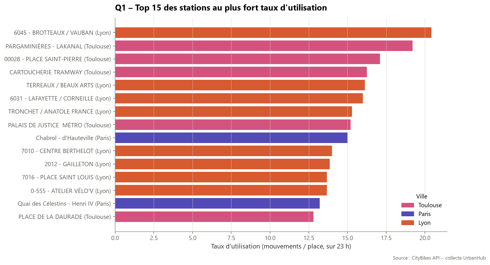

# Partie 2 – Flux streaming : mobilité urbaine

> Les passages entre crochets `[…]` sont à remplacer par les chiffres affichés dans `notebooks/02_velos.ipynb` (lignes « Chiffre clé ») après la dernière exécution.

## 2.1 Source et collecte

- **Source** : CityBikes API (`https://api.citybik.es/v2/networks`), qui agrège en temps réel l'état des stations de vélos en libre-service du monde entier.
- **Périmètre** : réseaux français des 8 villes de `config.py` ([liste des réseaux affichée au lancement : velib, velov, …]).
- **Ingestion** : `p2_citybikes_stream.py` effectue un relevé **toutes les 150 secondes** (2 min 30). L'API publique CityBikes est limitée à 300 unités de quota par heure, et une requête coûte d'autant plus d'unités que le réseau est grand (mesuré : ~25 unités pour Vélib' et ses ~1 500 stations, ~1 à 3 pour les autres réseaux). Le script lit le quota restant et le coût réel de chaque réseau dans les en-têtes de réponse (`ratelimit-remaining`, `ratelimit-reset`) et répartit le budget sur l'heure : il ne dépasse jamais le quota et ne s'interrompt jamais. Pour **Paris**, suivre Vélib' toutes les 2–3 min via CityBikes coûterait ~600 unités/h : on interroge donc directement le **flux GBFS open data officiel de Vélib' Métropole** (la source qu'agrège CityBikes), sans quota (`network_id = velib-gbfs`). Chaque relevé est ajouté au data lake dans `data/raw/citybikes/date=YYYY-MM-DD/snapshots.csv`, partitionné par jour. La collecte tourne sans interruption, relancée automatiquement par une boucle PowerShell en cas d'erreur.
- **Volume obtenu** : [N] relevés sur [D] h ([début] → [fin] UTC), [S] stations, [L] lignes brutes.

| Variable | Description |
|---|---|
| `station_id`, `station_name` | Identifiant et nom de la station |
| `latitude`, `longitude` | Position (°) |
| `bikes_available` | Vélos disponibles |
| `free_slots` | Places libres |
| `timestamp` | Dernière mise à jour de la station (source) |
| `poll_time` | Heure du relevé UrbanHub (UTC) |

## 2.2 Traitement

1. Concaténation des relevés, conversion de `poll_time` en UTC.
2. Dédoublonnage sur (`station_id`, `poll_time`).
3. `capacity = bikes_available + free_slots`. Les stations de capacité nulle (fermées) sont retirées : [X] lignes.
4. Indicateurs : `occupancy = bikes / capacity`, `delta` = |variation du nombre de vélos entre deux relevés| (estimation des vélos pris ou rendus), `empty` / `full`.
5. Sorties : `data/clean/bikes.parquet` (détail) et `data/clean/bikes_city_hourly.parquet` (mouvements et occupation par ville × heure UTC, validé par `check_city_hourly()`, utilisé dans la partie 4).

## 2.3 Résultats

### Q1 – Stations au plus fort taux d'utilisation
*Méthode* : taux d'utilisation = mouvements / capacité (rotations par place).

*Chiffre clé* : la station [nom] ([ville]) atteint [X] rotations par place, contre une médiane de [Y].
*Interprétation* : [2–3 phrases]

### Q2 – Zones à offre insuffisante
*Méthode* : part du temps où chaque station est vide ; regroupement par zones d'environ 1 km.

*Chiffre clé* : [X] stations ([Y] %) sont vides plus de 20 % du temps ; [Z] zones sont en offre insuffisante.
*Interprétation* : [2–3 phrases]

### Q3 – Pics d'utilisation journaliers
*Méthode* : mouvements par station et par heure, moyennés par heure de la journée (heure de Paris).

*Chiffre clé* : pic à [H] h ([X] mouvements/h), creux à [H'] h.
*Interprétation* : [2–3 phrases]

### Q4 – Déséquilibres géographiques
*Méthode* : occupation moyenne de chaque station parisienne cartographiée (carte interactive : `figures/p2_q4_carte_paris.html`).

*Chiffre clé* : occupation moyenne de [X] % au [secteur] contre [Y] % au [secteur].
*Interprétation* : [2–3 phrases]

### Q5 – Stations critiques à rééquilibrer
*Méthode* : vide plus de 30 % du temps → à recharger ; pleine plus de 30 % du temps → à vider.

*Chiffre clé* : [X] stations à recharger et [Y] à vider ([Z] % du parc).
*Interprétation* : [2–3 phrases]

## 2.4 Limites

- **Pas d'historique** : CityBikes ne fournit que l'état courant des stations. L'historique « depuis l'existence du réseau » demandé n'est pas accessible via cette API. L'étude porte sur [D] h de collecte, et chaque heure de la journée n'est observée qu'une ou deux fois : les résultats sont des **tendances observées**, pas des moyennes stables.
- **Quota CityBikes et double source pour Paris** : le quota gratuit ne permet pas de suivre Vélib' assez souvent ; Paris provient donc du flux GBFS officiel Vélib' (mêmes données, identifiants de stations différents : la première heure collectée via CityBikes pour Vélib' est écartée pour éviter les doublons). Les autres villes peuvent être relevées un peu moins souvent quand le quota est serré. Une clé API (info@citybik.es) lèverait cette limite.
- **Interruption** : collecte interrompue de [17:15] à [heure de reprise] (déplacement de la machine de collecte).
- **Mouvements estimés** : `delta` mesure la variation nette entre deux relevés. Un vélo pris puis un autre rendu dans les mêmes 2 minutes ne sont pas comptés. Les camions de rééquilibrage sont aussi comptés comme des mouvements.
- **Choix d'architecture** : interrogation régulière de l'API et stockage partitionné par date plutôt qu'un bus de messages (Kafka), compte tenu du délai de 24 h. En production, le script deviendrait un producteur Kafka et le nettoyage un consommateur.

## 2.5 Conclusion

[3–4 phrases : stations et zones clés, rythme journalier, recommandations de rééquilibrage pour l'opérateur]
