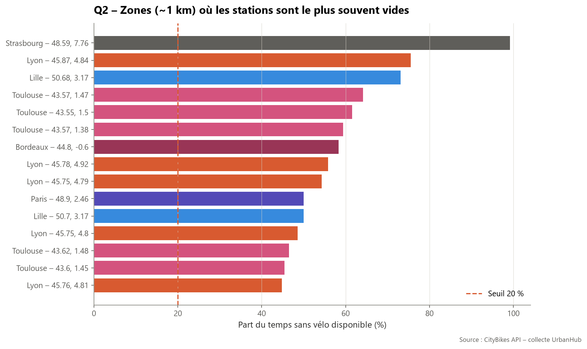
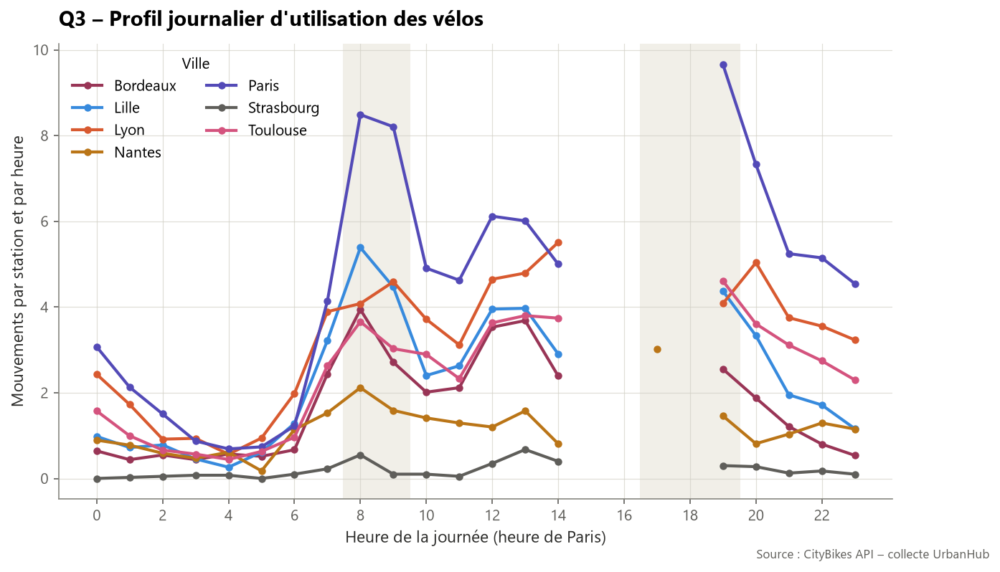
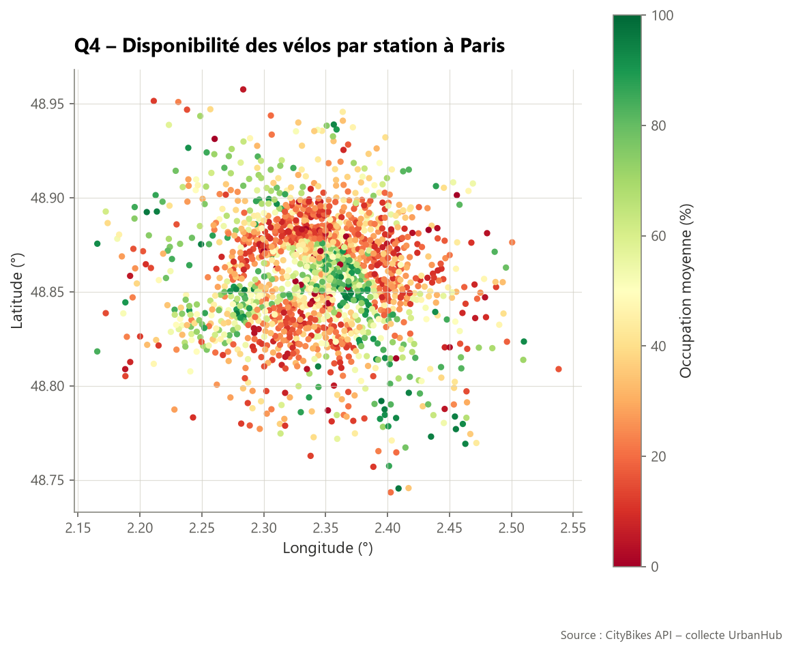
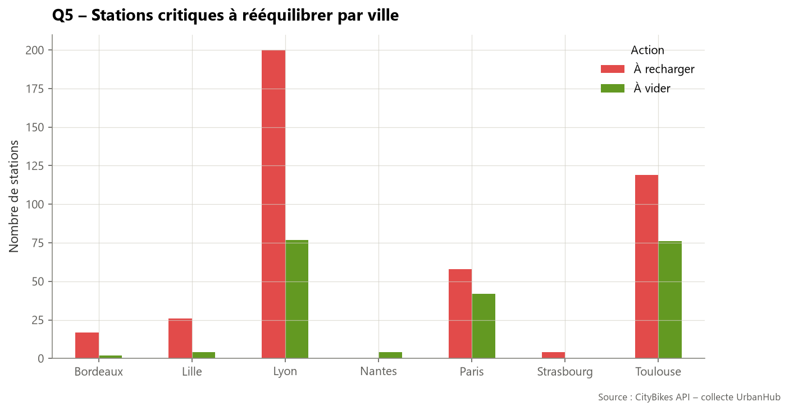

# Partie 2 – Flux streaming : mobilité urbaine

## 2.1 Source et collecte

- **Source** : CityBikes API (`https://api.citybik.es/v2/networks`), qui agrège en temps réel l'état des stations de vélos en libre-service du monde entier.
- **Périmètre** : réseaux des 8 villes de `config.py` : Vélib' Métropole (Paris), Vélo'v (Lyon), VélÔToulouse, V'Lille, V³ (Bordeaux), Bicloo et Chantrerie Captain Bike (Nantes), Vélhop (Strasbourg), le vélo (Marseille).
- **Ingestion** : `p2_citybikes_stream.py` effectue un relevé **toutes les 150 secondes** (2 min 30). L'API publique CityBikes est limitée à 300 unités de quota par heure, et une requête coûte d'autant plus d'unités que le réseau est grand (mesuré : ~25 unités pour Vélib' et ses ~1 500 stations, ~1 à 3 pour les autres réseaux). Le script lit le quota restant et le coût réel de chaque réseau dans les en-têtes de réponse (`ratelimit-remaining`, `ratelimit-reset`) et répartit le budget sur l'heure : il ne dépasse jamais le quota et ne s'interrompt jamais. Pour **Paris**, suivre Vélib' toutes les 2–3 min via CityBikes coûterait ~600 unités/h : on interroge donc directement le **flux GBFS open data officiel de Vélib' Métropole** (la source qu'agrège CityBikes), sans quota (`network_id = velib-gbfs`). Chaque relevé est ajouté au data lake dans `data/raw/citybikes/date=YYYY-MM-DD/snapshots.csv`, partitionné par jour. La collecte tourne sans interruption, relancée automatiquement par une boucle PowerShell en cas d'erreur.
- **Volume obtenu** : 502 relevés sur 23,2 h (19/11 15:00 → 20/11 14:10 UTC), 1 646 192 lignes brutes, 1 481 263 lignes après nettoyage, **3 065 stations dans 7 villes** (Paris 1 518, Lyon 493, Toulouse 457, Lille 266, Bordeaux 221, Nantes 70, Strasbourg 40).

| Variable | Description |
|---|---|
| `station_id`, `station_name` | Identifiant et nom de la station |
| `latitude`, `longitude` | Position (°) |
| `bikes_available` | Vélos disponibles |
| `free_slots` | Places libres |
| `timestamp` | Dernière mise à jour de la station (source) |
| `poll_time` | Heure du relevé UrbanHub (UTC) |

## 2.2 Traitement

1. Concaténation des relevés, conversion de `poll_time` en UTC.
2. Dédoublonnage sur (`station_id`, `poll_time`).
3. `capacity = bikes_available + free_slots`. Les stations de capacité nulle (fermées) sont retirées ; au total 164 929 lignes écartées (doublons, stations fermées, Marseille, Cergy-Pontoise).
4. Indicateurs : `occupancy = bikes / capacity`, `delta` = |variation du nombre de vélos entre deux relevés| (estimation des vélos pris ou rendus), `empty` / `full`.
5. Sorties : `data/clean/bikes.parquet` (détail) et `data/clean/bikes_city_hourly.parquet` (mouvements et occupation par ville × heure UTC, validé par `check_city_hourly()`, utilisé dans la partie 4).

## 2.3 Résultats

### Q1 – Stations au plus fort taux d'utilisation
*Méthode* : taux d'utilisation = mouvements / capacité (rotations par place).

*Chiffre clé* : la station **6045 – Brotteaux / Vauban (Lyon)** atteint 19,9 rotations par place sur la période, soit près de 8 fois la médiane de l'ensemble des stations (2,52). Usage médian par ville : Lyon 2,96 ; Paris 2,87 ; Toulouse 2,36 ; Bordeaux 1,56 ; Lille 1,43 ; Nantes 0,82 ; Strasbourg 0,10.

*Interprétation* : l'utilisation est très concentrée : une minorité de stations, situées dans les hypercentres, près des pôles d'emploi et des gares (quartier de la Part-Dieu à Lyon par exemple), tourne beaucoup plus vite que les autres. Lyon, Paris et Toulouse forment le trio de tête, avec des réseaux denses et très utilisés. Le très faible score de Strasbourg s'explique par la nature de Vélhop, surtout tourné vers la location de moyenne et longue durée plutôt que vers le libre-service en station.

### Q2 – Zones à offre insuffisante
*Méthode* : part du temps où chaque station est vide ; regroupement par zones d'environ 1 km.

*Chiffre clé* : 673 stations (17 % des stations analysées) sont vides plus de 20 % du temps, et 66 zones d'environ 1 km sont en offre insuffisante. Les zones les plus touchées sont vides de 50 % à 99 % du temps (Strasbourg, nord et est de Lyon, secteur de Roubaix pour Lille, sud de Toulouse, est de la proche banlieue parisienne).

*Interprétation* : les zones en sous-offre sont presque toutes situées en périphérie des agglomérations, et non dans les centres. Les vélos y sont pris le matin pour rejoindre le centre mais reviennent peu : ces stations se vident et restent vides une grande partie de la journée. Une partie d'entre elles ne compte que 2 à 4 stations, ce qui rend la zone très sensible au moindre départ. Ce sont des cibles prioritaires pour ajouter des vélos ou des points d'attache.

### Q3 – Pics d'utilisation journaliers
*Méthode* : mouvements par station et par heure, moyennés par heure de la journée (heure de Paris).

*Chiffre clé* : pic du matin à **8 h** (4,0 mouvements par station et par heure, moyenne des 7 villes) et pic du soir à **19 h** (3,9), contre 0,5 au creux de 4 h, soit 8 fois moins. À Paris, les pics atteignent 8,5 (8 h) et 9,7 (19 h) mouvements par station et par heure.

*Interprétation* : le profil est nettement bimodal, avec deux pointes aux heures des trajets domicile–travail et une activité quasi nulle la nuit : le vélo en libre-service sert d'abord aux déplacements pendulaires. Paris présente une intensité environ deux fois supérieure à la moyenne, et un pic du soir plus marqué que celui du matin, les retours étant complétés par des déplacements de loisirs. Le creux de fin de matinée (vers 10–11 h) puis la reprise du midi confirment ce rythme. Ce profil repose sur une seule journée (jeudi soir → vendredi) : chaque heure n'est observée qu'une fois.

### Q4 – Déséquilibres géographiques
*Méthode* : occupation moyenne de chaque station parisienne cartographiée (carte interactive : `figures/p2_q4_carte_paris.html`).

*Chiffre clé* : occupation moyenne de 47,7 % dans le centre (< 3 km de Châtelet), **33,5 % dans l'anneau parisien de 3 à 6 km** et 46,5 % en proche banlieue. Le centre cumule la plus forte part de temps à vide (7,4 %) et à plein (5,5 %).

*Interprétation* : la disponibilité n'est pas homogène. Les arrondissements périphériques de Paris (3–6 km) sont les plus dégarnis : ils servent de points de départ et se vident plus qu'ils ne se remplissent. Le centre est le plus instable, avec à la fois le plus de stations vides et le plus de stations pleines : forte attractivité, mais flux très déséquilibrés selon l'heure. La banlieue, rarement vide (3,4 % du temps), est la mieux équilibrée sur la journée.

### Q5 – Stations critiques à rééquilibrer
*Méthode* : vide plus de 30 % du temps → à recharger ; pleine plus de 30 % du temps → à vider.

*Chiffre clé* : **439 stations à recharger** (vides plus de 30 % du temps) et **211 à vider** (pleines plus de 30 % du temps), soit 17 % du parc. Lyon, Toulouse et Paris concentrent l'essentiel des stations critiques.

*Interprétation* : les stations à recharger sont deux fois plus nombreuses que celles à vider : le problème principal est le manque de vélos là où ils partent, plus que le manque de places. En croisant avec Q2 et Q4, le rééquilibrage devrait recharger en priorité les stations périphériques avant le pic de 8 h, puis vider les stations centrales saturées en fin de matinée et avant le pic de 19 h.

## 2.4 Limites

- **Pas d'historique** : CityBikes ne fournit que l'état courant des stations. L'historique « depuis l'existence du réseau » demandé n'est pas accessible via cette API. L’étude porte sur 23 h de collecte, et chaque heure de la journée n'est observée qu'une ou deux fois : les résultats sont des **tendances observées**, pas des moyennes stables.
- **Quota CityBikes et double source pour Paris** : le quota gratuit ne permet pas de suivre Vélib' assez souvent ; Paris provient donc du flux GBFS officiel Vélib' (mêmes données, identifiants de stations différents : la première heure collectée via CityBikes pour Vélib' est écartée pour éviter les doublons). Les autres villes peuvent être relevées un peu moins souvent quand le quota est serré. Une clé API (info@citybik.es) lèverait cette limite.
- **Interruption** : collecte interrompue de 17:15 à 18:53 le 19/11 (déplacement de la machine de collecte). Aucun mouvement n'est calculé à travers ce trou, et les heures partiellement couvertes sont ramenées à un équivalent heure complète.
- **Marseille exclue** : le flux CityBikes du réseau *le-velo* est resté figé pendant toute la collecte (0 vélo disponible dans toutes les stations, aucun mouvement), probablement une panne côté source. Ces données inexploitables sont écartées ; l'analyse porte sur 7 villes.
- **Cergy-Pontoise écartée** : le réseau *VélO2* (Cergy-Pontoise, ~25 km de Paris) était rattaché à Paris par proximité géographique ; il est exclu pour ne garder que Vélib' Métropole.
- **Mouvements estimés** : `delta` mesure la variation nette entre deux relevés. Un vélo pris puis un autre rendu dans les mêmes 2 minutes ne sont pas comptés. Les camions de rééquilibrage sont aussi comptés comme des mouvements.
- **Choix d'architecture** : interrogation régulière de l'API et stockage partitionné par date plutôt qu'un bus de messages (Kafka), compte tenu du délai de 24 h. En production, le script deviendrait un producteur Kafka et le nettoyage un consommateur.

## 2.5 Conclusion

Sur 23 heures et 3 065 stations, le vélo en libre-service apparaît comme un mode de transport pendulaire : deux pics nets à 8 h et 19 h, une activité huit fois plus faible la nuit, et une intensité à Paris deux fois supérieure à celle des autres villes. Les déséquilibres sont surtout spatiaux : à Paris, l'anneau de 3 à 6 km du centre se vide tandis que le centre alterne entre stations vides et pleines. L'usage est très concentré (jusqu'à 8 fois la médiane pour la station la plus active, à Lyon), et 650 stations, soit 17 % du parc, sont critiques : 439 à recharger et 211 à vider. Pour l'opérateur, le rééquilibrage devrait cibler en priorité ces stations critiques avant les pics de 8 h et de 19 h. Ces résultats portent sur une seule journée et gagneraient à être confirmés sur plusieurs semaines (clé API CityBikes, archives data.citybik.es).
