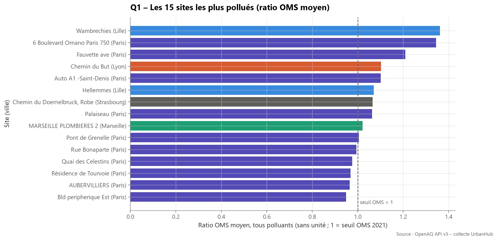
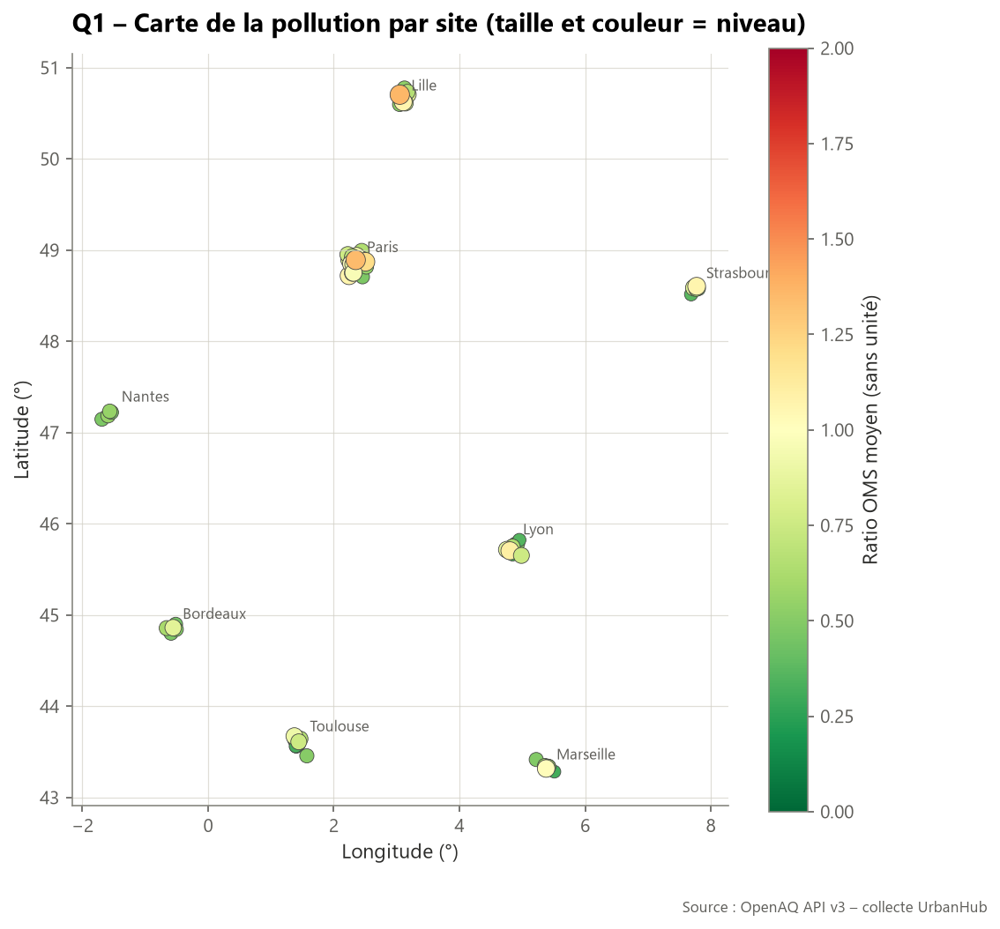
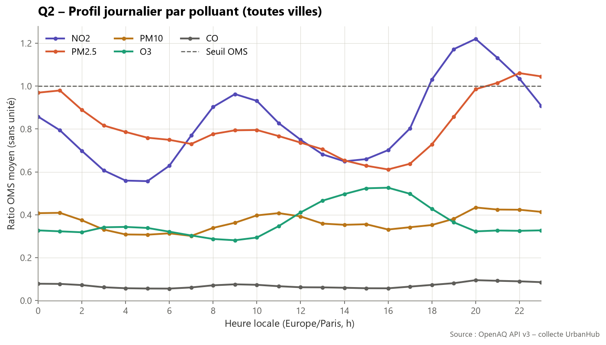
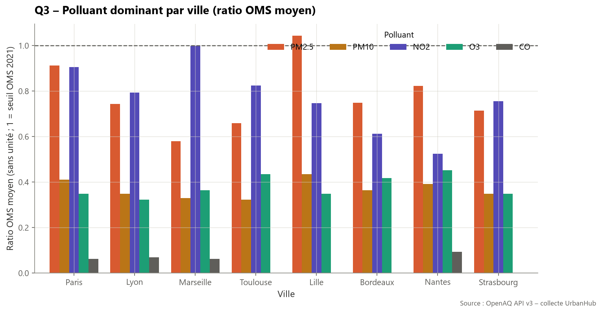
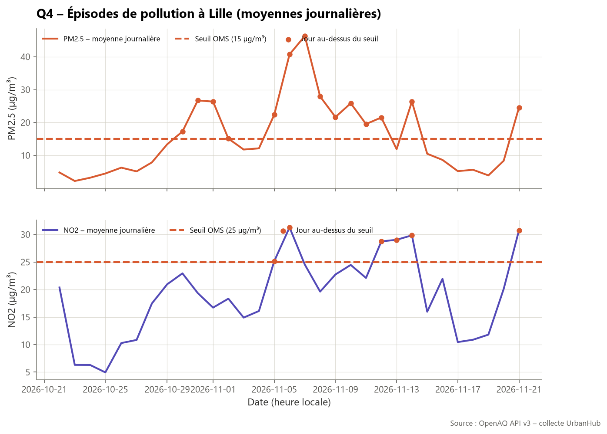

# Partie 3 – Flux IoT : pollution de l'air

> Auteur : chef de projet · Branche `partie3-rapport` · Résultats issus de `notebooks/03_pollution.ipynb` (données OpenAQ du 22/10/2026 au 21/11/2026).

## 3.1 Source et ingestion

- **Source** : OpenAQ API v3, qui agrège les mesures de capteurs de qualité de l'air (réseaux institutionnels et capteurs communautaires). Une clé d'API gratuite est nécessaire ; la limite est d'environ 60 requêtes par minute et par clé.
- **Périmètre** : les capteurs de PM2.5, PM10, NO2, O3 et CO situés dans une boîte de ±0,2° en longitude et ±0,15° en latitude autour de chacune des 8 villes de `config.py`, vus dans les 7 derniers jours.
- **Ingestion** (`p3_openaq_iot.py`) :
  1. `discover` : liste les capteurs actifs → `data/raw/openaq/sensors.csv` (**213 capteurs** actifs : Paris 57, Lyon 29, Toulouse 27, Bordeaux 20, Strasbourg 19, Marseille 18, Lille 17, Nantes 10) ;
  2. `backfill --days 30` : historique horaire de chaque capteur → `data/raw/openaq/history/<capteur>.csv` ;
  3. `stream --interval 600` : simulation d'un flux IoT, un relevé « latest » de tous les sites toutes les 10 minutes → `data/raw/openaq/stream/date=AAAA-MM-JJ/readings.csv`, partitionné par jour.
- **Volume** : 111 299 mesures horaires, 202 capteurs ayant des données, environ 10 Mo de données brutes.

| Variable | Description |
|---|---|
| `sensor_id`, `location_id` | Identifiants du capteur et du site |
| `city` | Ville de `config.py` |
| `pollutant` | pm25, pm10, no2, o3, co |
| `value`, `unit` | Mesure et unité (toutes en µg/m³) |
| `timestamp` | Début de la période de mesure (UTC) |
| `latitude`, `longitude` | Position du site (°) |

## 3.2 Traitement

1. Concaténation de l'historique et du flux, `timestamp` converti en UTC.
2. Dédoublonnage sur (`sensor_id`, `timestamp`) : 0 doublon sur la période ; suppression des valeurs négatives (erreurs capteur) : 0.
3. Vérification des unités : toutes les mesures sont déjà en µg/m³, aucune conversion ppm/ppb n'a été nécessaire (le code gère néanmoins ces cas).
4. `hour` = `timestamp` arrondi à l'heure (UTC), puis table `data/clean/pollution_city_hourly.parquet` : moyenne des capteurs de la ville, un polluant par colonne (5 474 lignes, 8 villes), validée par `check_city_hourly()` et utilisée dans la partie 4.
5. Comparaison aux **seuils OMS 2021** : PM2.5 = 15, PM10 = 45, NO2 = 25, O3 = 100, CO = 4 000 µg/m³ ; on raisonne en ratio (valeur / seuil) pour comparer des polluants entre eux.

## 3.3 Résultats

### Q1 – Zones les plus polluées

**Méthode** : moyenne par capteur, puis par site, du ratio OMS (valeur / seuil OMS 2021), tous polluants confondus ; classement des 15 sites les plus élevés et carte (taille et couleur = niveau).

**Graphiques** : `figures/p3_q1_top_sites.png`, `figures/p3_q1_carte_pollution.png` (et la carte interactive `figures/p3_q1_carte_pollution.html`).

**Chiffre clé** : les sites les plus exposés sont Wambrechies (Lille, ratio 1,36), Boulevard Ornano (Paris, 1,34), Fauvette avenue (Paris, 1,21) et Chemin du But (Lyon, 1,10) ; Auto A1 – Saint-Denis (Paris, 1,10) est le seul de ce haut de classement à mesurer 3 polluants. Par ville, le ratio moyen le plus élevé est celui du PM2.5 à Lille (1,04), du NO2 à Marseille (1,00) et du PM2.5 / NO2 à Paris (0,91).

**Interprétation** : les zones les plus polluées sont les sites exposés au trafic (boulevards parisiens, autoroute A1, périphérie de Lille) : la pollution est surtout un phénomène de proximité routière. Plusieurs sites du classement ne mesurent qu'un seul polluant, leur ratio dépend donc de ce polluant et il faut les comparer avec prudence.

### Q2 – Variation journalière

**Méthode** : moyenne du ratio OMS par heure locale (Europe/Paris) et par polluant, sur les 30 jours de collecte.

**Graphique** : `figures/p3_q2_profil_journalier.png`.

**Chiffre clé** : le NO2 culmine à 20 h (ratio 1,22) et est au plus bas à 5 h (0,56) ; dans 6 villes sur 8 le pic NO2 est à 20 h, dans les deux autres à 19 h. Le PM2.5 est maximal à 22 h (1,06) et minimal à 16 h (0,61). L'ozone est maximal à 16 h (0,53) et minimal à 9 h (0,28).

**Interprétation** : le NO2, polluant du trafic, suit les heures de forte circulation, avec un pic tardif (19–20 h) qu'on peut relier au trafic du soir et à une couche limite atmosphérique plus basse en automne. Le PM2.5 monte en soirée (chauffage résidentiel et trafic). L'ozone, polluant secondaire formé avec le rayonnement solaire, atteint son maximum l'après-midi, comme attendu, mais à un niveau bas en novembre.

### Q3 – Polluant dominant par ville

**Méthode** : ratio OMS moyen par ville et par polluant (barres groupées), pour comparer des polluants de natures différentes sur une même échelle.

**Graphique** : `figures/p3_q3_polluant_dominant.png`.

**Chiffre clé** : le polluant dominant est le PM2.5 à Paris (0,91), Lille (1,04), Bordeaux (0,75) et Nantes (0,82), et le NO2 à Lyon (0,79), Marseille (1,00), Toulouse (0,83) et Strasbourg (0,76). Le PM10 reste sous 0,45 et l'ozone sous 0,45 partout ; le CO est négligeable (≤ 0,09, mesuré dans 4 villes seulement).

**Interprétation** : en automne, la pollution urbaine est dominée par les particules fines et le dioxyde d'azote, qui frôlent ou dépassent le seuil OMS dans plusieurs villes. Les villes du Sud (Marseille, Toulouse) et de l'Est sont plutôt « NO2 », celles du Nord et de l'Ouest plutôt « PM2.5 ».

### Q4 – Épisodes anormaux

**Méthode** : moyenne journalière par ville et polluant comparée au seuil OMS ; pics repérés par z-score > 3 ; graphique de la ville qui cumule le plus de jours au-dessus du seuil en PM2.5 (Lille), avec ligne horizontale au seuil.

**Graphique** : `figures/p3_q4_episodes.png`.

**Chiffre clé** : sur 30 jours, Lille dépasse le seuil PM2.5 (15 µg/m³) 14 jours, avec un pic à près de 46 µg/m³ autour du 7 novembre (environ 3 fois le seuil). Marseille dépasse le seuil NO2 16 jours, Paris 12 jours en NO2 et 11 en PM2.5. L'ozone et le CO ne dépassent jamais leur seuil. Seuls 2 pics extrêmes (z > 3) sont détectés, pour le CO le 7 novembre (Paris, Marseille).

**Interprétation** : le principal épisode de la période se situe autour du 7 novembre, avec des particules fines très élevées dans le Nord, et des dépassements NO2 répétés dans les grandes villes. Le pic de CO du 7 novembre à Paris et à Marseille le même jour suggère un phénomène commun aux deux villes ; la partie 4 testera si la météo (vent faible, absence de pluie) l'explique.

## 3.4 Limites

- **Durée** : 30 jours (22/10 – 21/11/2026) : l'étude décrit une période d'automne, pas un régime annuel ; l'ozone, polluant estival, est sous-représenté.
- **Couverture inégale** : de 3 capteurs de PM2.5 (Nantes) à 19 (Paris) ; le CO n'est mesuré que dans 4 villes (Paris, Lyon, Marseille, Nantes) par un capteur chacun. Les moyennes par ville dépendent de l'implantation des capteurs (sites de trafic ou de fond).
- **Seuils OMS** : définis sur 24 h (8 h pour l'O3) ; appliqués ici à des moyennes horaires ou journalières, c'est une approximation pour situer les niveaux, pas une évaluation réglementaire.
- **Unités** : toutes les mesures arrivent déjà en µg/m³ ; aucune conversion ppm/ppb n'a été nécessaire.
- **Flux IoT** : le mode `stream` interroge l'API « latest » toutes les 10 min (flux simulé) ; il complète l'historique horaire mais le volume reste limité.
