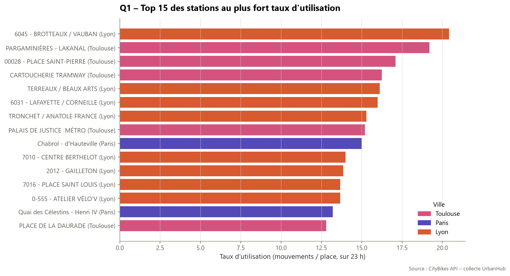
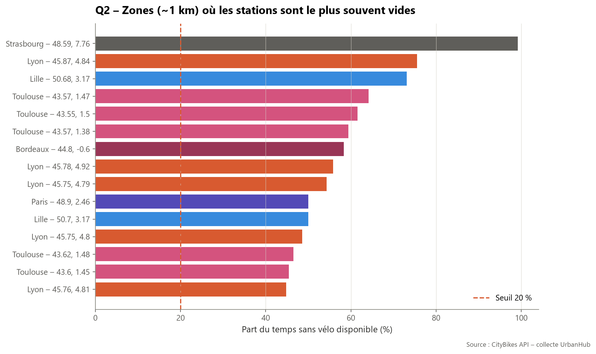
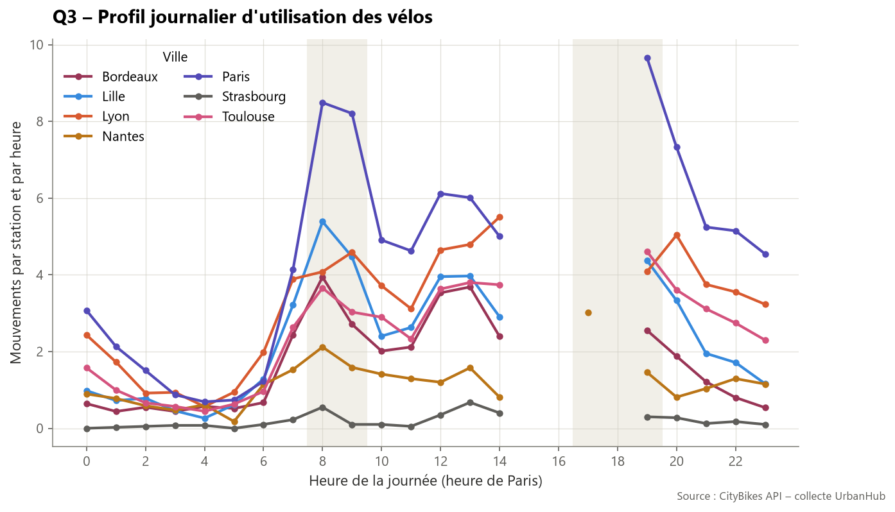
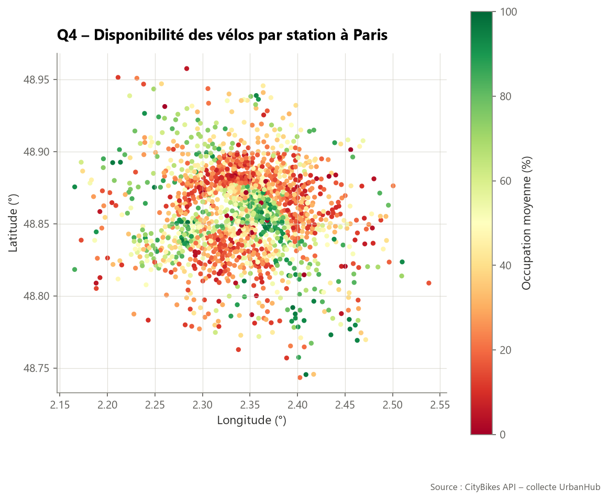
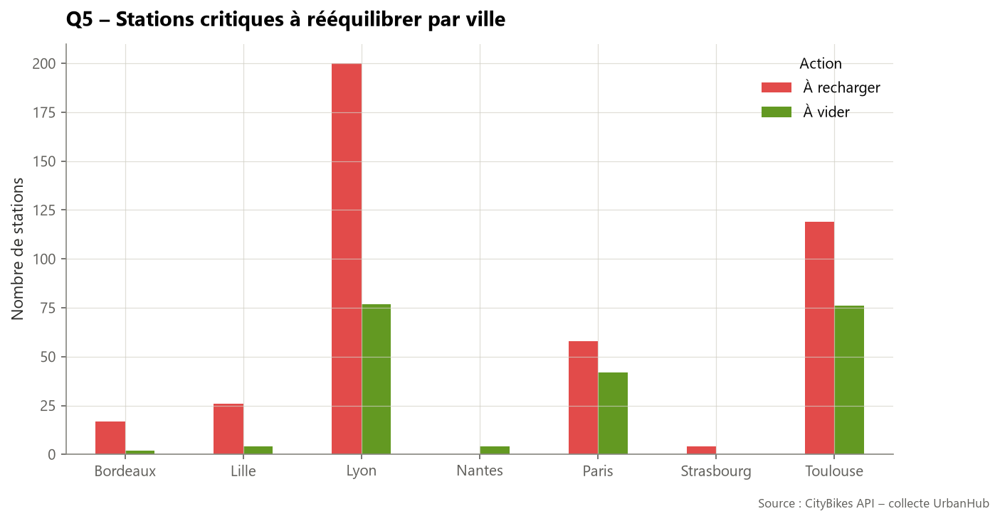
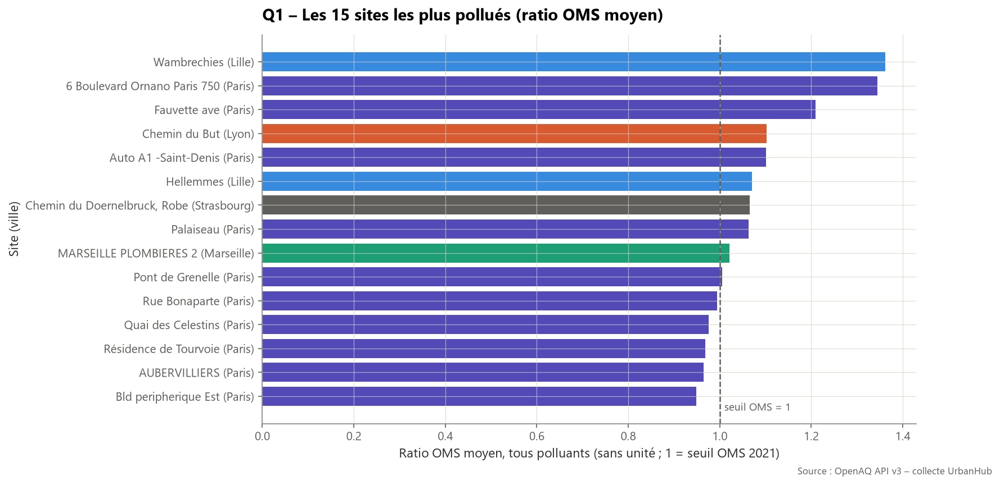
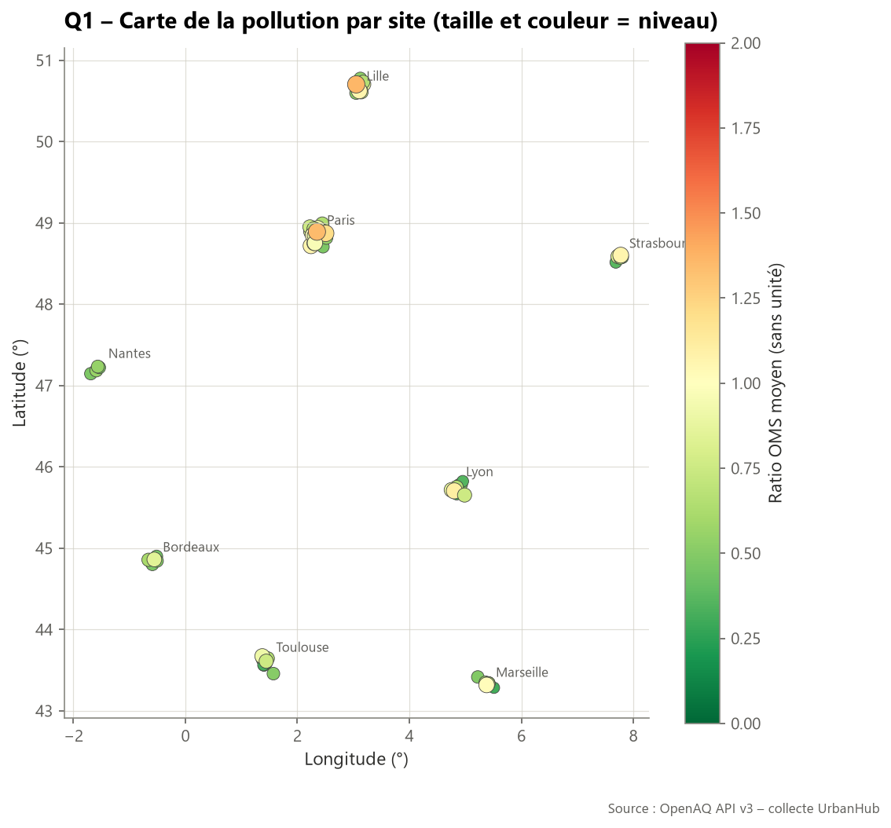
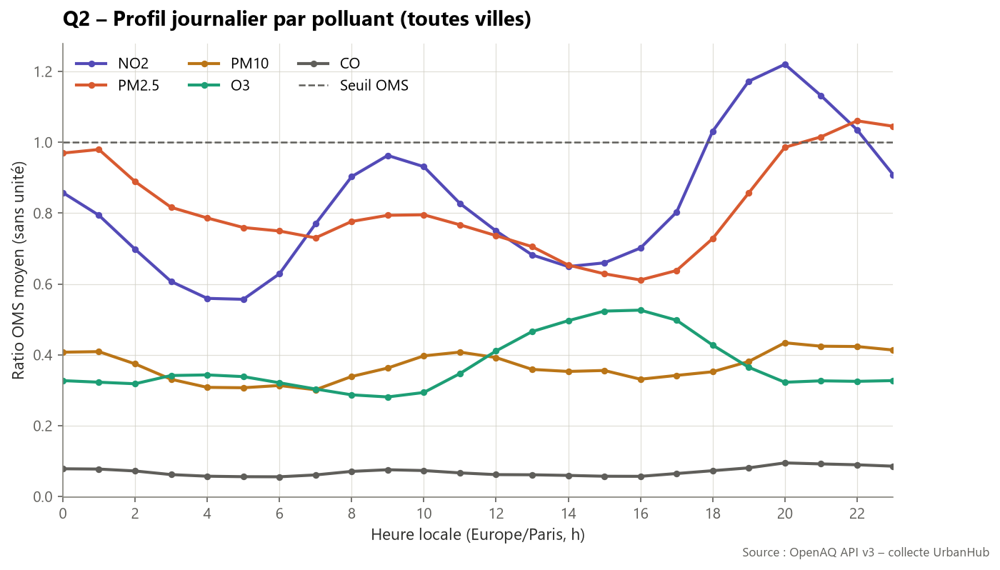
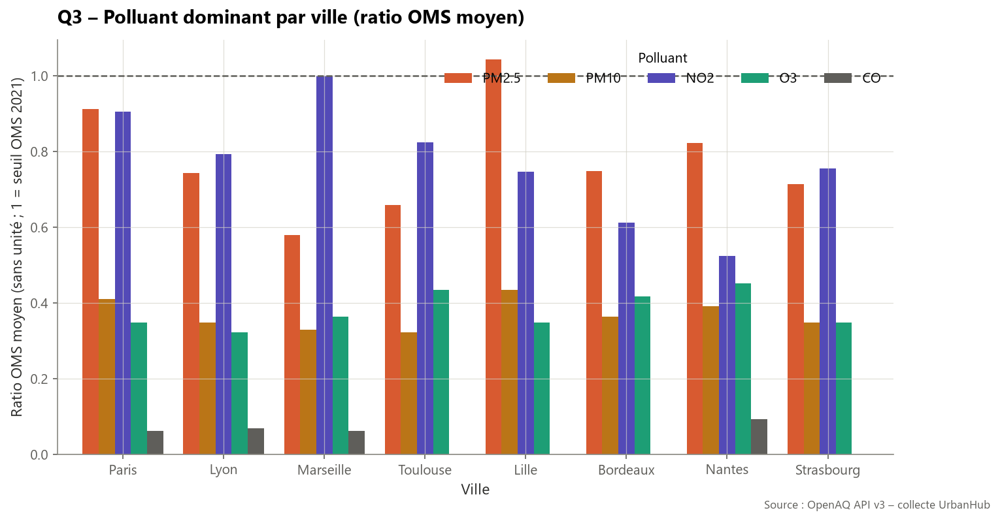
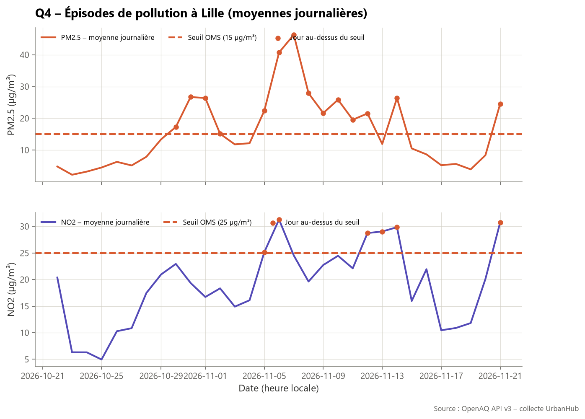

# UrbanHub – Jumeau numérique de la qualité de vie urbaine

*Projet Smart City · 8 villes françaises · météo × mobilité × pollution*

## 1. Introduction

Une ville intelligente repose sur des données urbaines collectées en continu : conditions météorologiques, usage des transports, qualité de l'air. Ces données arrivent sous des formes très différentes : fichiers historiques volumineux, API temps réel, capteurs IoT. UrbanHub est un prototype de **jumeau numérique** : il ingère ces trois types de flux, les stocke dans un data lake commun, les nettoie, puis les croise pour répondre à des questions de décideurs (où la mobilité douce est-elle freinée ? quand l'air est-il le plus dégradé ? la météo explique-t-elle une partie des comportements ?).

**Villes étudiées** (définies dans `config.py`, communes aux trois flux) : Paris, Lyon, Marseille, Toulouse, Lille, Bordeaux, Nantes, Strasbourg.

**Équipe et répartition** : Partie 1 (météo, flux batch) : Rayan. Partie 2 (vélos, flux streaming) : Redouane. Partie 3 (pollution, flux IoT) et assemblage du rapport : chef de projet. Partie 4 (analyse croisée) : Rayan, avec les trois membres.

## 2. Architecture

```
 SOURCES                 INGESTION               DATA LAKE                TRAITEMENT          ANALYSE              INDICATEURS
 ───────                 ─────────               ─────────                ──────────          ───────              ───────────
 NOAA Global Hourly ──►  p1_noaa_batch.py   ──►  data/raw/noaa/        ──► nettoyage pandas ─► notebooks 01..03 ─►  graphiques PNG
 (fichiers, batch)       32 téléchargements      <année>/<station>.csv    (décodage, bornes,    (4 + 5 + 4          cartes folium
                         parallèles                                        UTC, ville)          questions)          rapport
 CityBikes + GBFS   ──►  p2_citybikes_stream.py► data/raw/citybikes/   ──► dédoublonnage,    ─►                  tableau de bord
 (API, streaming)        relevé / 150 s          date=AAAA-MM-JJ/          capacité, delta                         Streamlit
                                                 snapshots.csv                                  notebook 04
 OpenAQ API v3      ──►  p3_openaq_iot.py      ──► data/raw/openaq/       ──► unités → µg/m³, ─► (analyse croisée,
 (capteurs IoT)          discover / backfill /    sensors.csv, history/,    ratio OMS            4 questions)
                         stream (10 min)          stream/date=…/
                                          │
                                          ▼
                              data/clean/*.parquet   +   *_city_hourly.parquet
                              clés communes : city (config.py) × hour (UTC, dt.floor("h"))
```

**Rôle des trois types de flux**

| Flux | Source | Mode | Fréquence | Rôle |
|---|---|---|---|---|
| Batch | NOAA Global Hourly | téléchargement de fichiers | une fois (reprise possible) | contexte climatique long (5 ans) |
| Streaming | CityBikes API / flux GBFS Vélib' | interrogation d'API | un relevé toutes les 150 s | usage des vélos en libre-service |
| IoT | OpenAQ API v3 (capteurs de qualité de l'air) | historique horaire + relevés « latest » | historique 30 jours, puis un relevé toutes les 10 min | niveaux de polluants |

**Principe d'intégration** : chaque flux produit une table `*_city_hourly.parquet` avec les mêmes clés (`city` = noms exacts de `config.py`, `hour` = heure UTC arrondie). La partie 4 se réduit alors à des jointures sur `(city, hour)`. Le script `urbanhub_utils.check_city_hourly()` vérifie ces conventions avant chaque écriture.

---

# Partie 1 — Météo (flux batch NOAA Global Hourly)

> Auteur : Rayan · Branche `meteo` · Résultats issus de `notebooks/01_meteo.ipynb` (données NOAA du 1er janvier 2021 au 24 août 2025).

## 1. Objectif et source

Cette partie construit le flux **batch** météo d'UrbanHub à partir du jeu **NOAA Global Hourly** (observations horaires de stations). L'objectif est de produire, pour chacune des 8 villes du projet, une série météo horaire propre (`weather_city_hourly.parquet`) réutilisable par l'analyse croisée (Partie 4), puis d'en tirer 4 analyses (anomalies, visibilité, saisonnalité, jours extrêmes).

## 2. Architecture du flux batch

```
NOAA (un CSV par station et par année)
   │  python p1_noaa_batch.py download   (32 téléchargements parallèles, reprise possible)
   ▼
data/raw/noaa/<année>/<station>.csv      (données brutes, jamais sur Git)
   │  python p1_noaa_batch.py clean      (décodage, qualité, bornes, rattachement ville, agrégation horaire)
   ▼
data/clean/weather_city_hourly.parquet   (clés : city, hour UTC) → committé sur Git
```

- **Villes** : Paris, Lyon, Marseille, Toulouse, Lille, Bordeaux, Nantes, Strasbourg (noms lus dans `config.py`).
- **Sélection des stations** : stations françaises actives depuis 5 ans situées à **50 km au plus** d'une des 8 villes, soit **30 stations**. Période demandée : 2021 à 2026 (6 années), soit 180 fichiers.
- **Téléchargement** : 32 requêtes en parallèle (durée observée : environ 40 secondes). Résultat : **150 fichiers téléchargés et 30 absents** (code 404). Les données disponibles s'arrêtent au **24 août 2025** : aucun fichier 2026 n'était disponible lors du téléchargement.
- **Reprise** : un fichier déjà présent n'est pas retéléchargé ; la commande peut être relancée après une coupure.
- **Fiabilisation** : lors des premiers essais, le serveur a renvoyé des pages HTML au lieu de CSV. Le script vérifie désormais que le contenu est un CSV NOAA (en-tête `STATION`) avant de l'enregistrer, écrit d'abord dans un fichier temporaire (`.part`), puis signale les fichiers invalides au nettoyage sans les supprimer.
- **Volume des données brutes** : environ **0,93 Go** (931 Mo, 150 fichiers CSV de stations).

### Résultat du nettoyage

| Ville | Stations rattachées (max) | Heures dans le fichier final |
|---|---|---|
| Paris | 10 | 40 167 |
| Lyon | 5 | 40 133 |
| Marseille | 5 | 40 129 |
| Toulouse | 5 | 40 128 |
| Nantes | 2 | 40 141 |
| Bordeaux | 1 | 40 109 |
| Lille | 1 | 39 979 |
| Strasbourg | 1 | 40 104 |
| **Total** | **30** | **320 890 lignes** |

Période couverte : du **1er janvier 2021 00:00 UTC au 24 août 2025 21:00 UTC** (environ 40 700 heures par ville, soit une couverture d'environ 98,5 %).

## 3. Décodage et nettoyage

Les champs NOAA sont des chaînes encodées (`valeur,code_qualité`). Le nettoyage applique :

| Champ | Format NOAA | Décodage | Valeur manquante |
|---|---|---|---|
| `TMP` | température en dixièmes de °C | ÷ 10 → °C | `+9999` |
| `WND` | direction, qualité, type, vitesse (dixièmes de m/s), qualité | vitesse ÷ 10 → m/s | `9999` (vitesse), `999` (direction) |
| `SLP` | pression au niveau de la mer en dixièmes de hPa | ÷ 10 → hPa | `99999` |
| `VIS` | visibilité en mètres | ÷ 1000 → km | `999999` |
| `AA1` | précipitations : durée (h), hauteur en dixièmes de mm, condition, qualité | hauteur ÷ 10 → mm ; durée conservée (`precip_period_h`) | `9999` |

Règles complémentaires :
- **Sentinelles** (999 / 9999 / 99999 / 999999) converties en valeurs manquantes (`NaN`), jamais traitées comme des mesures.
- **Codes qualité** : les mesures de qualité **2, 3, 6, 7** (suspectes ou erronées, y compris après contrôle manuel) sont **écartées**.
- **Bornes physiques** : température −70 à 60 °C, vent 0 à 100 m/s, pression 850 à 1100 hPa, visibilité 0 à 160 km, précipitations 0 à 300 mm ; au-delà, la valeur est rejetée.
- **Précipitations** : le cumul est donné sur une durée variable (1, 3, 6, 12, 24 h). Seuls les cumuls sur **1 heure** (`precip_period_h == 1`) sont conservés, pour éviter tout double comptage.
- **Rattachement à la ville** : chaque station est rattachée à la **ville la plus proche** (distance de Haversine, seuil de 50 km) à partir de ses coordonnées dans les fichiers.
- **Agrégation** : d'abord par station et par heure, puis moyenne des stations de la même ville : une ligne par `(city, hour)`, avec `hour` = heure UTC arrondie (`.dt.floor("h")`).
- **Colonnes finales** : `city, hour, temp_c, wind_ms, slp_hpa, vis_km, precip_mm, precip_period_h, n_stations`.

### Taux de valeurs manquantes avant / après nettoyage

| Variable | Manquants avant nettoyage (%) | Manquants après nettoyage (%) | Manquants grille horaire par ville (%) |
|---|---|---|---|
| Température (°C) | 3,5 | 3,7 | 1,6 |
| Vent (m/s) | 0,1 | 0,1 | 1,5 |
| Pression (hPa) | 66,2 | 66,2 | 14,9 |
| Visibilité (km) | 3,1 | 3,1 | 1,5 |
| Précipitations 1 h (mm) | 66,4 | 77,7 | 43,3 |

*Avant* = valeur absente ou sentinelle ; *après* = + codes qualité écartés + bornes physiques (+ cumul sur 1 h seulement pour les précipitations) ; *grille* = part d'heures sans valeur par ville après agrégation sur une grille horaire complète.

Lecture :
- **Température, vent, visibilité** : quasi complètes ; le contrôle qualité n'écarte presque rien (+0,2 point pour la température).
- **Pression** : le champ `SLP` est absent de la majorité des observations (66,2 %), mais la fusion des stations et des rapports d'une même heure ramène le manque à 14,9 % par ville.
- **Précipitations** : le champ `AA1` est absent de 66,4 % des observations (l'absence de champ ne permet pas de distinguer « pas de pluie » de « non mesuré »). Le passage de 66,4 % à 77,7 % vient de la règle « cumul sur 1 h uniquement » (+11,3 points), qui est le choix délibéré pour éviter le double comptage.

## 4. Analyses (notebook `01_meteo.ipynb`)

Les données sont agrégées par jour **en heure de Paris** (jours avec au moins 18 heures de mesures) : **13 362 jours-ville** pour les 8 villes, de janvier 2021 à août 2025. Les graphiques sont dans `figures/p1_*.png`.

### Q1 — Anomalies de température
- **Méthode** : z-score de la température moyenne journalière par rapport à la normale du mois et de la ville ; anomalie si |z| > 2,5.
- **Graphique** : `figures/p1_q1_anomalies_paris.png`
- **Chiffre clé** : **99 jours-ville anormaux** sur 13 362 (0,7 %), dont **60 chauds et 39 froids**. Par ville : Nantes 18, Toulouse 17, Paris 15, Lille 13, Marseille 10, Strasbourg 10, Bordeaux 9, Lyon 7. Le plus extrême est Lille le 19/07/2022 : 30,0 °C pour une normale de juillet de 19,4 °C (z = 4,06) ; à Paris, le même jour : 30,4 °C contre 20,3 °C (z = 3,54).
- **Interprétation** : les anomalies chaudes dominent (61 %) et se concentrent sur quelques épisodes visibles dans le top 10 : **18–19 juillet 2022** (Nantes z = 3,91, Bordeaux z = 3,23, Lille, Paris) et le **1er juillet 2025** (Lille z = 3,77, Paris z = 3,44). Le 18 juillet 2022 correspond à la canicule historique de l'ouest de la France, où Nantes a battu son record absolu avec environ 42 °C (Brut, Connexion France). Les anomalies froides sont plus rares et moins intenses (par exemple Lille le 09/02/2021 : −5,1 °C, z = −3,28).

### Q2 — Météo × visibilité
- **Méthode** : corrélations de Spearman, boxplot de visibilité pluie vs sec, brouillard (visibilité < 1 km et vent < 2 m/s).
- **Graphiques** : `p1_q2_heatmap_spearman.png`, `p1_q2_boxplot_visibilite_pluie.png`, `p1_q2_brouillard.png`
- **Chiffre clé** : visibilité médiane de **12,3 km par temps de pluie contre 15,9 km par temps sec** ; corrélation de Spearman visibilité~pluie **ρ = −0,19**. Fréquence du brouillard : de 0,07 % des heures (Marseille) à **1,46 % (Strasbourg)**, puis Bordeaux 1,21 %, Lille 1,10 %, Toulouse 0,93 %, Nantes 0,51 %, Lyon 0,25 %, Paris 0,17 %. Heure locale la plus brumeuse (toutes villes) : **6 h**.
- **Interprétation** : la pluie réduit la visibilité, mais la corrélation reste faible : d'autres phénomènes (brume, humidité) jouent aussi. Le brouillard est rare et concerne surtout des villes de l'intérieur ou de plaine (Strasbourg, Bordeaux, Lille), avec un maximum en fin de nuit, quand le vent est faible et l'air le plus froid.

### Q3 — Saisonnalité
- **Méthode** : courbes mensuelles par ville (température et pluie) et tendance annuelle (régression linéaire) sur les **années complètes uniquement** : 4 années (2021 à 2024), car 2025 s'arrête en août.
- **Graphiques** : `p1_q3_saisonnalite.png`, `p1_q3_tendance_annuelle.png`
- **Chiffre clé** : amplitude entre le mois le plus chaud et le plus froid : Marseille 19,0 °C, Lyon et Toulouse 18,4 °C, Strasbourg 17,8 °C, Bordeaux 16,1 °C, Paris 15,8 °C, Lille 15,6 °C, **Nantes 13,9 °C**. Tendance annuelle : pentes positives de **+0,15 à +0,47 °C/an** selon la ville (Paris +0,27 °C/an, p = 0,49), **aucune significative** (p entre 0,30 et 0,74).
- **Interprétation** : la saisonnalité est nette et l'amplitude est la plus faible à Nantes, ville la plus océanique. Les pentes sont toutes positives mais statistiquement non significatives : avec seulement 4 années, elles ne permettent pas de conclure à une tendance climatique et restent descriptives.

### Q4 — Jours extrêmes
- **Méthode** : percentiles 1 et 99 par ville de tmax, tmin, vent max et précipitations journalières.
- **Graphique** : `p1_q4_jours_extremes_paris.png` ; tableau des 20 dernières dates dans `figures/p1_q4_20_dernieres_dates.csv`.
- **Chiffre clé** : environ 810 jours-ville extrêmes : jour très froid 139, chaleur extrême 139, nuit très chaude 138, nuit très froide 137, vent extrême 136, pluie extrême 121. Seuils de Paris : tmax P99 = 33,1 °C, tmin P99 = 19,6 °C. Les 20 dernières dates extrêmes sont toutes comprises entre le **13 et le 17 août 2025** (exemples : Bordeaux 39,0 °C le 15/08, seuil 37,0 °C ; Toulouse 38,8 °C le 13/08 ; Lyon 38,7 °C le 13/08 ; Marseille 38,3 °C le 16/08 et nuit à 26,0 °C le 17/08).
- **Validation externe** : ces dates correspondent à la **canicule d'août 2025** : vigilance rouge du 11 au 13 août dans le sud-ouest, puis nouveau pic les 15 et 16 août dans l'ouest et le sud (Santé publique France, Météo Paris). Le **18 juillet 2022** (Nantes, record absolu d'environ 42 °C) est également retrouvé en Q1.
- **Interprétation** : par construction, un percentile 1 et 99 produit un nombre de jours extrêmes voisin pour chaque type ; l'intérêt est la date. Les événements les plus récents sont tous des épisodes de chaleur, ce qui valide le nettoyage : un épisode connu est bien retrouvé dans les données. Les précipitations extrêmes sont moins nombreuses (121), car le cumul horaire n'est pas toujours renseigné.

## 5. Limites

- **Fin des données au 24 août 2025** : aucune donnée NOAA 2026. L'analyse croisée avec les flux collectés en 2026 (Partie 4) nécessite donc la météo de secours Open-Meteo.
- **Couverture inégale** : 10 stations pour Paris, mais une seule pour Bordeaux, Lille et Strasbourg ; une station peut ne pas représenter toute l'agglomération.
- **Précipitations** : seuls les cumuls sur 1 h sont retenus et l'absence de champ ne distingue pas « pas de pluie » de « non mesuré » ; les cumuls de pluie sont donc probablement sous-estimés.
- **Pression** : 14,9 % de manquants après agrégation.
- **Durée** : environ 4,7 ans de données ; la saisonnalité est visible, pas une tendance climatique.

## 6. Reproductibilité

```bash
python p1_noaa_batch.py all     # download + clean
python -m jupyter nbconvert --to notebook --execute --inplace notebooks/01_meteo.ipynb
```

---

# Partie 2 – Flux streaming : mobilité urbaine


## 2.1 Source et collecte

- **Source** : CityBikes API (`https://api.citybik.es/v2/networks`), qui agrège en temps réel l'état des stations de vélos en libre-service du monde entier.
- **Périmètre** : réseaux des 8 villes de `config.py` : Vélib' Métropole (Paris), Vélo'v (Lyon), VélÔToulouse, V'Lille, V³ (Bordeaux), Bicloo et Chantrerie Captain Bike (Nantes), Vélhop (Strasbourg), le vélo (Marseille).
- **Ingestion** : `p2_citybikes_stream.py` effectue un relevé **toutes les 150 secondes** (2 min 30). L'API publique CityBikes est limitée à 300 unités de quota par heure, et une requête coûte d'autant plus d'unités que le réseau est grand (mesuré : ~25 unités pour Vélib' et ses ~1 500 stations, ~1 à 3 pour les autres réseaux). Le script lit le quota restant et le coût réel de chaque réseau dans les en-têtes de réponse (`ratelimit-remaining`, `ratelimit-reset`) et répartit le budget sur l'heure : il ne dépasse jamais le quota et ne s'interrompt jamais. Pour **Paris**, suivre Vélib' toutes les 2–3 min via CityBikes coûterait ~600 unités/h : on interroge donc directement le **flux GBFS open data officiel de Vélib' Métropole** (la source qu'agrège CityBikes), sans quota (`network_id = velib-gbfs`). Chaque relevé est ajouté au data lake dans `data/raw/citybikes/date=YYYY-MM-DD/snapshots.csv`, partitionné par jour. La collecte tourne sans interruption, relancée automatiquement par une boucle PowerShell en cas d'erreur.
- **Volume obtenu** : 502 relevés sur 23,2 h (19/11 15:00 → 20/11 14:10 UTC), 1 646 192 lignes brutes, 1 481 263 lignes après nettoyage, **3 065 stations dans 7 villes** (Paris 1 518, Lyon 493, Toulouse 457, Lille 266, Bordeaux 221, Nantes 70, Strasbourg 40).

| Variable | Description |
|---|---|
| `station_id`, `station_name` | Identifiant et nom de la station |
| `latitude`, `longitude` | Position (°) |
| `bikes_available` | Vélos disponibles |
| `free_slots` | Places libres |
| `timestamp` | Dernière mise à jour de la station (source) |
| `poll_time` | Heure du relevé UrbanHub (UTC) |

## 2.2 Traitement

1. Concaténation des relevés, conversion de `poll_time` en UTC.
2. Dédoublonnage sur (`station_id`, `poll_time`).
3. `capacity = bikes_available + free_slots`. Les stations de capacité nulle (fermées) sont retirées ; au total 164 929 lignes écartées (doublons, stations fermées, Marseille, Cergy-Pontoise).
4. Indicateurs : `occupancy = bikes / capacity`, `delta` = |variation du nombre de vélos entre deux relevés| (estimation des vélos pris ou rendus), `empty` / `full`.
5. Sorties : `data/clean/bikes.parquet` (détail) et `data/clean/bikes_city_hourly.parquet` (mouvements et occupation par ville × heure UTC, validé par `check_city_hourly()`, utilisé dans la partie 4).

## 2.3 Résultats

### Q1 – Stations au plus fort taux d'utilisation
*Méthode* : taux d'utilisation = mouvements / capacité (rotations par place).

*Chiffre clé* : la station **6045 – Brotteaux / Vauban (Lyon)** atteint 19,9 rotations par place sur la période, soit près de 8 fois la médiane de l'ensemble des stations (2,52). Usage médian par ville : Lyon 2,96 ; Paris 2,87 ; Toulouse 2,36 ; Bordeaux 1,56 ; Lille 1,43 ; Nantes 0,82 ; Strasbourg 0,10.
*Interprétation* : l'utilisation est très concentrée : une minorité de stations, situées dans les hypercentres, près des pôles d'emploi et des gares (quartier de la Part-Dieu à Lyon par exemple), tourne beaucoup plus vite que les autres. Lyon, Paris et Toulouse forment le trio de tête, avec des réseaux denses et très utilisés. Le très faible score de Strasbourg s'explique par la nature de Vélhop, surtout tourné vers la location de moyenne et longue durée plutôt que vers le libre-service en station.

### Q2 – Zones à offre insuffisante
*Méthode* : part du temps où chaque station est vide ; regroupement par zones d'environ 1 km.

*Chiffre clé* : 673 stations (17 % des stations analysées) sont vides plus de 20 % du temps, et 66 zones d'environ 1 km sont en offre insuffisante. Les zones les plus touchées sont vides de 50 % à 99 % du temps (Strasbourg, nord et est de Lyon, secteur de Roubaix pour Lille, sud de Toulouse, est de la proche banlieue parisienne).
*Interprétation* : les zones en sous-offre sont presque toutes situées en périphérie des agglomérations, et non dans les centres. Les vélos y sont pris le matin pour rejoindre le centre mais reviennent peu : ces stations se vident et restent vides une grande partie de la journée. Une partie d'entre elles ne compte que 2 à 4 stations, ce qui rend la zone très sensible au moindre départ. Ce sont des cibles prioritaires pour ajouter des vélos ou des points d'attache.

### Q3 – Pics d'utilisation journaliers
*Méthode* : mouvements par station et par heure, moyennés par heure de la journée (heure de Paris).

*Chiffre clé* : pic du matin à **8 h** (4,0 mouvements par station et par heure, moyenne des 7 villes) et pic du soir à **19 h** (3,9), contre 0,5 au creux de 4 h, soit 8 fois moins. À Paris, les pics atteignent 8,5 (8 h) et 9,7 (19 h) mouvements par station et par heure.
*Interprétation* : le profil est nettement bimodal, avec deux pointes aux heures des trajets domicile–travail et une activité quasi nulle la nuit : le vélo en libre-service sert d'abord aux déplacements pendulaires. Paris présente une intensité environ deux fois supérieure à la moyenne, et un pic du soir plus marqué que celui du matin, les retours étant complétés par des déplacements de loisirs. Le creux de fin de matinée (vers 10–11 h) puis la reprise du midi confirment ce rythme. Ce profil repose sur une seule journée (jeudi soir → vendredi) : chaque heure n'est observée qu'une fois.

### Q4 – Déséquilibres géographiques
*Méthode* : occupation moyenne de chaque station parisienne cartographiée (carte interactive : `figures/p2_q4_carte_paris.html`).

*Chiffre clé* : occupation moyenne de 47,7 % dans le centre (< 3 km de Châtelet), **33,5 % dans l'anneau parisien de 3 à 6 km** et 46,5 % en proche banlieue. Le centre cumule la plus forte part de temps à vide (7,4 %) et à plein (5,5 %).
*Interprétation* : la disponibilité n'est pas homogène. Les arrondissements périphériques de Paris (3–6 km) sont les plus dégarnis : ils servent de points de départ et se vident plus qu'ils ne se remplissent. Le centre est le plus instable, avec à la fois le plus de stations vides et le plus de stations pleines : forte attractivité, mais flux très déséquilibrés selon l'heure. La banlieue, rarement vide (3,4 % du temps), est la mieux équilibrée sur la journée.

### Q5 – Stations critiques à rééquilibrer
*Méthode* : vide plus de 30 % du temps → à recharger ; pleine plus de 30 % du temps → à vider.

*Chiffre clé* : **439 stations à recharger** (vides plus de 30 % du temps) et **211 à vider** (pleines plus de 30 % du temps), soit 17 % du parc. Lyon, Toulouse et Paris concentrent l'essentiel des stations critiques.
*Interprétation* : les stations à recharger sont deux fois plus nombreuses que celles à vider : le problème principal est le manque de vélos là où ils partent, plus que le manque de places. En croisant avec Q2 et Q4, le rééquilibrage devrait recharger en priorité les stations périphériques avant le pic de 8 h, puis vider les stations centrales saturées en fin de matinée et avant le pic de 19 h.

## 2.4 Limites

- **Pas d'historique** : CityBikes ne fournit que l'état courant des stations. L'historique « depuis l'existence du réseau » demandé n'est pas accessible via cette API. L’étude porte sur 23 h de collecte, et chaque heure de la journée n'est observée qu'une ou deux fois : les résultats sont des **tendances observées**, pas des moyennes stables.
- **Quota CityBikes et double source pour Paris** : le quota gratuit ne permet pas de suivre Vélib' assez souvent ; Paris provient donc du flux GBFS officiel Vélib' (mêmes données, identifiants de stations différents : la première heure collectée via CityBikes pour Vélib' est écartée pour éviter les doublons). Les autres villes peuvent être relevées un peu moins souvent quand le quota est serré. Une clé API (info@citybik.es) lèverait cette limite.
- **Interruption** : collecte interrompue de 17:15 à 18:53 le 19/11 (déplacement de la machine de collecte). Aucun mouvement n'est calculé à travers ce trou, et les heures partiellement couvertes sont ramenées à un équivalent heure complète.
- **Marseille exclue** : le flux CityBikes du réseau *le-velo* est resté figé pendant toute la collecte (0 vélo disponible dans toutes les stations, aucun mouvement), probablement une panne côté source. Ces données inexploitables sont écartées ; l'analyse porte sur 7 villes.
- **Cergy-Pontoise écartée** : le réseau *VélO2* (Cergy-Pontoise, ~25 km de Paris) était rattaché à Paris par proximité géographique ; il est exclu pour ne garder que Vélib' Métropole.
- **Mouvements estimés** : `delta` mesure la variation nette entre deux relevés. Un vélo pris puis un autre rendu dans les mêmes 2 minutes ne sont pas comptés. Les camions de rééquilibrage sont aussi comptés comme des mouvements.
- **Choix d'architecture** : interrogation régulière de l'API et stockage partitionné par date plutôt qu'un bus de messages (Kafka), compte tenu du délai de 24 h. En production, le script deviendrait un producteur Kafka et le nettoyage un consommateur.

## 2.5 Conclusion

Sur 23 heures et 3 065 stations, le vélo en libre-service apparaît comme un mode de transport pendulaire : deux pics nets à 8 h et 19 h, une activité huit fois plus faible la nuit, et une intensité à Paris deux fois supérieure à celle des autres villes. Les déséquilibres sont surtout spatiaux : à Paris, l'anneau de 3 à 6 km du centre se vide tandis que le centre alterne entre stations vides et pleines. L'usage est très concentré (jusqu'à 8 fois la médiane pour la station la plus active, à Lyon), et 650 stations, soit 17 % du parc, sont critiques : 439 à recharger et 211 à vider. Pour l'opérateur, le rééquilibrage devrait cibler en priorité ces stations critiques avant les pics de 8 h et de 19 h. Ces résultats portent sur une seule journée et gagneraient à être confirmés sur plusieurs semaines (clé API CityBikes, archives data.citybik.es).

---

# Partie 3 – Flux IoT : pollution de l'air

> Auteur : chef de projet · Branche `partie3-rapport` · Résultats issus de `notebooks/03_pollution.ipynb` (données OpenAQ du 22/10/2026 au 21/11/2026).

## 3.1 Source et ingestion

- **Source** : OpenAQ API v3, qui agrège les mesures de capteurs de qualité de l'air (réseaux institutionnels et capteurs communautaires). Une clé d'API gratuite est nécessaire ; la limite est d'environ 60 requêtes par minute et par clé.
- **Périmètre** : les capteurs de PM2.5, PM10, NO2, O3 et CO situés dans une boîte de ±0,2° en longitude et ±0,15° en latitude autour de chacune des 8 villes de `config.py`, vus dans les 7 derniers jours.
- **Ingestion** (`p3_openaq_iot.py`) :
  1. `discover` : liste les capteurs actifs → `data/raw/openaq/sensors.csv` (**213 capteurs** actifs : Paris 57, Lyon 29, Toulouse 27, Bordeaux 20, Strasbourg 19, Marseille 18, Lille 17, Nantes 10) ;
  2. `backfill --days 30` : historique horaire de chaque capteur → `data/raw/openaq/history/<capteur>.csv` ;
  3. `stream --interval 600` : simulation d'un flux IoT, un relevé « latest » de tous les sites toutes les 10 minutes → `data/raw/openaq/stream/date=AAAA-MM-JJ/readings.csv`, partitionné par jour.
- **Volume** : 111 299 mesures horaires, 202 capteurs ayant des données, environ 10 Mo de données brutes.

| Variable | Description |
|---|---|
| `sensor_id`, `location_id` | Identifiants du capteur et du site |
| `city` | Ville de `config.py` |
| `pollutant` | pm25, pm10, no2, o3, co |
| `value`, `unit` | Mesure et unité (toutes en µg/m³) |
| `timestamp` | Début de la période de mesure (UTC) |
| `latitude`, `longitude` | Position du site (°) |

## 3.2 Traitement

1. Concaténation de l'historique et du flux, `timestamp` converti en UTC.
2. Dédoublonnage sur (`sensor_id`, `timestamp`) : 0 doublon sur la période ; suppression des valeurs négatives (erreurs capteur) : 0.
3. Vérification des unités : toutes les mesures sont déjà en µg/m³, aucune conversion ppm/ppb n'a été nécessaire (le code gère néanmoins ces cas).
4. `hour` = `timestamp` arrondi à l'heure (UTC), puis table `data/clean/pollution_city_hourly.parquet` : moyenne des capteurs de la ville, un polluant par colonne (5 474 lignes, 8 villes), validée par `check_city_hourly()` et utilisée dans la partie 4.
5. Comparaison aux **seuils OMS 2021** : PM2.5 = 15, PM10 = 45, NO2 = 25, O3 = 100, CO = 4 000 µg/m³ ; on raisonne en ratio (valeur / seuil) pour comparer des polluants entre eux.

## 3.3 Résultats

### Q1 – Zones les plus polluées


**Méthode** : moyenne par capteur, puis par site, du ratio OMS (valeur / seuil OMS 2021), tous polluants confondus ; classement des 15 sites les plus élevés et carte (taille et couleur = niveau).

**Graphiques** : `figures/p3_q1_top_sites.png`, `figures/p3_q1_carte_pollution.png` (et la carte interactive `figures/p3_q1_carte_pollution.html`).

**Chiffre clé** : les sites les plus exposés sont Wambrechies (Lille, ratio 1,36), Boulevard Ornano (Paris, 1,34), Fauvette avenue (Paris, 1,21) et Chemin du But (Lyon, 1,10) ; Auto A1 – Saint-Denis (Paris, 1,10) est le seul de ce haut de classement à mesurer 3 polluants. Par ville, le ratio moyen le plus élevé est celui du PM2.5 à Lille (1,04), du NO2 à Marseille (1,00) et du PM2.5 / NO2 à Paris (0,91).

**Interprétation** : les zones les plus polluées sont les sites exposés au trafic (boulevards parisiens, autoroute A1, périphérie de Lille) : la pollution est surtout un phénomène de proximité routière. Plusieurs sites du classement ne mesurent qu'un seul polluant, leur ratio dépend donc de ce polluant et il faut les comparer avec prudence.

### Q2 – Variation journalière

**Méthode** : moyenne du ratio OMS par heure locale (Europe/Paris) et par polluant, sur les 30 jours de collecte.

**Graphique** : `figures/p3_q2_profil_journalier.png`.

**Chiffre clé** : le NO2 culmine à 20 h (ratio 1,22) et est au plus bas à 5 h (0,56) ; dans 6 villes sur 8 le pic NO2 est à 20 h, dans les deux autres à 19 h. Le PM2.5 est maximal à 22 h (1,06) et minimal à 16 h (0,61). L'ozone est maximal à 16 h (0,53) et minimal à 9 h (0,28).

**Interprétation** : le NO2, polluant du trafic, suit les heures de forte circulation, avec un pic tardif (19–20 h) qu'on peut relier au trafic du soir et à une couche limite atmosphérique plus basse en automne. Le PM2.5 monte en soirée (chauffage résidentiel et trafic). L'ozone, polluant secondaire formé avec le rayonnement solaire, atteint son maximum l'après-midi, comme attendu, mais à un niveau bas en novembre.

### Q3 – Polluant dominant par ville

**Méthode** : ratio OMS moyen par ville et par polluant (barres groupées), pour comparer des polluants de natures différentes sur une même échelle.

**Graphique** : `figures/p3_q3_polluant_dominant.png`.

**Chiffre clé** : le polluant dominant est le PM2.5 à Paris (0,91), Lille (1,04), Bordeaux (0,75) et Nantes (0,82), et le NO2 à Lyon (0,79), Marseille (1,00), Toulouse (0,83) et Strasbourg (0,76). Le PM10 reste sous 0,45 et l'ozone sous 0,45 partout ; le CO est négligeable (≤ 0,09, mesuré dans 4 villes seulement).

**Interprétation** : en automne, la pollution urbaine est dominée par les particules fines et le dioxyde d'azote, qui frôlent ou dépassent le seuil OMS dans plusieurs villes. Les villes du Sud (Marseille, Toulouse) et de l'Est sont plutôt « NO2 », celles du Nord et de l'Ouest plutôt « PM2.5 ».

### Q4 – Épisodes anormaux

**Méthode** : moyenne journalière par ville et polluant comparée au seuil OMS ; pics repérés par z-score > 3 ; graphique de la ville qui cumule le plus de jours au-dessus du seuil en PM2.5 (Lille), avec ligne horizontale au seuil.

**Graphique** : `figures/p3_q4_episodes.png`.

**Chiffre clé** : sur 30 jours, Lille dépasse le seuil PM2.5 (15 µg/m³) 14 jours, avec un pic à près de 46 µg/m³ autour du 7 novembre (environ 3 fois le seuil). Marseille dépasse le seuil NO2 16 jours, Paris 12 jours en NO2 et 11 en PM2.5. L'ozone et le CO ne dépassent jamais leur seuil. Seuls 2 pics extrêmes (z > 3) sont détectés, pour le CO le 7 novembre (Paris, Marseille).

**Interprétation** : le principal épisode de la période se situe autour du 7 novembre, avec des particules fines très élevées dans le Nord, et des dépassements NO2 répétés dans les grandes villes. Le pic de CO du 7 novembre à Paris et à Marseille le même jour suggère un phénomène commun aux deux villes ; la partie 4 testera si la météo (vent faible, absence de pluie) l'explique.

## 3.4 Limites

- **Durée** : 30 jours (22/10 – 21/11/2026) : l'étude décrit une période d'automne, pas un régime annuel ; l'ozone, polluant estival, est sous-représenté.
- **Couverture inégale** : de 3 capteurs de PM2.5 (Nantes) à 19 (Paris) ; le CO n'est mesuré que dans 4 villes (Paris, Lyon, Marseille, Nantes) par un capteur chacun. Les moyennes par ville dépendent de l'implantation des capteurs (sites de trafic ou de fond).
- **Seuils OMS** : définis sur 24 h (8 h pour l'O3) ; appliqués ici à des moyennes horaires ou journalières, c'est une approximation pour situer les niveaux, pas une évaluation réglementaire.
- **Unités** : toutes les mesures arrivent déjà en µg/m³ ; aucune conversion ppm/ppb n'a été nécessaire.
- **Flux IoT** : le mode `stream` interroge l'API « latest » toutes les 10 min (flux simulé) ; il complète l'historique horaire mais le volume reste limité.

---

# Partie 4 — Analyse croisée météo × pollution × vélos

> Auteur : Rayan, finalisé par le chef de projet · Résultats issus de `notebooks/04_croisement.ipynb`.

## 1. Objectif

Croiser les trois flux d'UrbanHub (météo NOAA, pollution OpenAQ, vélos CityBikes) pour observer comment la météo est associée à la qualité de l'air et à l'usage des vélos en libre-service.

## 2. Méthode de jointure

- Les trois fichiers `data/clean/*_city_hourly.parquet` partagent les mêmes clés : `city` (noms exacts de `config.py`) et `hour` (heure UTC arrondie avec `.dt.floor("h")`). Chaque fichier est vérifié avec `urbanhub_utils.check_city_hourly()`.
- Jointures sur `(city, hour)` :
  - `wp` = météo × pollution
  - `wpb` = `wp` × vélos
- Tailles et bornes temporelles : `wp` = 1 336 lignes, du 14/11/2026 0 h au 21/11/2026 13 h UTC, 8 villes ; `wpb` = 117 lignes, du 19/11/2026 18 h au 20/11/2026 13 h UTC, 7 villes (Marseille n'a pas de données vélos).
- **Plan B utilisé pour toute la partie 4** : les observations NOAA s'arrêtent le 24/08/2025, alors que la pollution (22/10–21/11/2026) et les vélos (19–20/11/2026) sont récentes ; la jointure météo NOAA × pollution est donc vide. La météo horaire provient d'**Open-Meteo** (`weather_recent_city_hourly.parquet`, 14–21/11/2026), la période commune étant limitée à la semaine couverte par ce fichier. Les quatre questions utilisent cette météo..

## 3. Précautions d'interprétation

- Les données vélos couvrent environ **20 heures** : nous parlons de **tendances observées**, non de lois générales.
- **Corrélation ≠ causalité.** L'**heure de la journée** est un facteur de confusion : le trafic, la pollution, la température et l'usage des vélos suivent tous un rythme quotidien. Pour la comparaison des mouvements de vélos, un indice relatif à la tranche de journée est utilisé (mouvements ÷ moyenne des mouvements de la même ville dans la même tranche : nuit, matin, après-midi, soir). Un indice « par heure » n'est pas possible : sur ~20 h de collecte il n'y a qu'une observation par ville et par heure.
- Les corrélations sont calculées avec le coefficient de **Spearman** (robuste aux distributions asymétriques et aux valeurs extrêmes).

## 4. Résultats

### Q1 — Vent ↔ NO2/PM, température ↔ O3, pluie ↔ PM
- **Méthode** : Spearman météo × polluants sur `wp`, heatmap + `regplot`.
- **Graphiques** : `figures/p4_q1_heatmap.png`, `figures/p4_q1_regplots.png`
- **Chiffre clé** : ρ vent ↔ NO2 = −0,56 (n = 1 274) ; vent ↔ PM2.5 = −0,42 (n = 1 312) ; vent ↔ PM10 = −0,33 (n = 1 250) ; température ↔ O3 = +0,28 (n = 1 242) ; pluie ↔ PM2.5 = −0,22 (n = 1 312) ; pluie ↔ PM10 = −0,31 (n = 1 250). Tous significatifs (p < 0,001).
- **Interprétation** : Plus le vent est fort, plus NO2 et particules sont faibles : le vent disperse les polluants primaires, l'effet le plus net (NO2). L'ozone est plus élevé quand il fait plus chaud (formation photochimique), l'association restant modérée. La pluie va avec des particules plus faibles, compatible avec un lessivage. Corrélation ≠ causalité : température, vent et pluie varient aussi avec le cycle quotidien.

### Q2 — Mouvements de vélos selon la pluie et la température
- **Méthode** : indice de mouvements relatif à la même ville et à la même tranche de journée ; boxplots pluie / pas de pluie et par tranche de température.
- **Graphique** : `figures/p4_q2_boxplots.png`
- **Chiffre clé** : indice médian 0,86 sous la pluie (n = 36) contre 1,00 sans pluie (n = 81) ; test de Mann-Whitney p = 0,22 (non significatif). Par température : 0,96 entre 5 et 10 °C (n = 33) et 0,98 entre 10 et 15 °C (n = 84), seules tranches observées.
- **Interprétation** : Les mouvements semblent environ 14 % plus faibles sous la pluie, mais la différence n'est pas statistiquement significative sur cet échantillon. La température n'a pas d'effet net sur une plage aussi étroite (5 à 15 °C). Tendance observée sur ~20 h seulement.

### Q3 — Meilleure combinaison pas de pluie × vent < 5 m/s × température
- **Méthode** : heatmap de l'indice moyen par combinaison pluie × vent × température, cellules de moins de 10 observations masquées.
- **Graphique** : `figures/p4_q3_heatmap_combinaisons.png`
- **Chiffre clé** : meilleure combinaison observée : pluie, vent < 5 m/s, 5–10 °C, indice 1,08 (n = 14) ; sans pluie, vent < 5 m/s : 1,02 (5–10 °C) et 1,00 (10–15 °C). Aucune cellule « vent ≥ 5 m/s » n'atteint 10 observations.
- **Interprétation** : Les écarts entre combinaisons sont faibles (indice entre 0,88 et 1,08) et ne permettent pas de désigner de condition clairement favorable ; le résultat « pluie » en tête est un artefact d'échantillon (n = 14), pas un effet réel. L'effet du vent fort ne peut pas être testé. Il faudrait une collecte de plusieurs semaines.

### Q4 — Vue d'ensemble pour Paris
- **Méthode** : z-scores superposés (mouvements, NO2, PM2.5, température) pour Paris + heatmap de corrélation globale.
- **Graphiques** : `figures/p4_q4_zscores_paris.png`, `figures/p4_q4_heatmap_globale.png`
- **Chiffre clé** : corrélations de Spearman avec les mouvements de vélos : NO2 +0,55, PM10 +0,37, CO +0,35, température +0,32, O3 −0,40, pluie −0,21, vent −0,08, PM2.5 −0,01. Fenêtre commune : 19/11 18 h → 20/11 13 h UTC (117 lignes, 7 villes).
- **Interprétation** : Les vélos co-varient surtout avec le NO2 (+0,55) : tous deux suivent le trafic urbain, donc le rythme quotidien (facteur de confusion) plutôt qu'un lien causal entre l'usage du vélo et la pollution. La corrélation négative avec l'ozone reflète l'inverse du cycle jour/nuit. Tendances observées uniquement, sur une seule journée de collecte.

## 5. Limites

- Fenêtre temporelle commune courte (~20 h) : résultats exploratoires.
- Un échantillon de pluie réduit rend les comparaisons fragiles.
- Stations de mesure ponctuelles supposées représentatives de la ville.
- Variables non mesurées (jour de la semaine, événements, trafic routier) pouvant expliquer une partie des tendances.

## 6. Conclusion

Le croisement des trois flux montre surtout un effet net de la météo sur la pollution : le vent disperse le NO2 (ρ = −0,56) et les particules, la pluie s'accompagne de particules plus faibles, la chaleur d'un ozone plus élevé. Pour les vélos, la pluie va avec un usage inférieur d'environ 14 % mais sans significativité (p = 0,22), et aucune combinaison de conditions ne ressort clairement. Ces résultats, obtenus sur une seule journée de collecte vélos et avec une météo Open-Meteo, sont exploratoires. Pour aller plus loin : collecter les vélos sur plusieurs semaines et estimer un modèle multivarié contrôlant l'heure de la journée et le jour de la semaine.

---

# Choix techniques et limites

## Choix techniques

- **Pas de Kafka ni de MQTT.** Avec un délai de 24 h, l'ingestion se fait par interrogation régulière des API (scripts Python) et par stockage partitionné par date dans un data lake de fichiers (`data/raw`, `data/clean`). Kafka et MQTT seraient l'étape suivante pour une mise en production : ils apporteraient la vraie diffusion d'événements, la reprise après panne et la montée en charge.
- **Pandas et Parquet.** Les volumes (quelques millions de lignes) tiennent en mémoire. Le Parquet, colonnaire et compressé, limite l'espace disque et conserve les types (dont les dates avec fuseau).
- **Clés de jointure communes.** `city` (noms exacts de `config.py`) et `hour` (heure UTC arrondie) sont imposées aux trois flux et vérifiées par `check_city_hourly()` ; sans cela la partie 4 ne fonctionne pas.
- **Git sans données brutes.** Seules les petites tables `*_city_hourly.parquet` sont versionnées ; les données brutes restent hors dépôt.

## Limites

- **Pas d'historique vélos.** CityBikes ne fournit que l'état temps réel des stations : l'étude vélos porte sur la période de collecte (environ 23 h), d'où des « tendances observées » et non des conclusions.
- **Quota CityBikes et Paris.** L'API publique est limitée à 300 unités par heure ; le réseau de Paris, très coûteux, est lu directement dans le flux GBFS officiel de Vélib' Métropole. Marseille n'a pas pu être couverte pour les vélos.
- **Décalage de publication NOAA.** Les observations NOAA exploitables s'arrêtent le 24 août 2025, alors que les flux vélos et pollution portent sur octobre–novembre 2026 : l'analyse croisée s'appuie donc sur la météo Open-Meteo (plan B) pour la période récente.
- **Durée de collecte courte** : 30 jours pour la pollution, environ 23 h pour les vélos.
- **Couverture inégale des capteurs** : de 3 à 19 capteurs de PM2.5 selon la ville, CO mesuré dans 4 villes seulement.
- **Corrélation n'est pas causalité** : l'heure de la journée influence à la fois le trafic, la pollution, la température et l'usage des vélos.

---

# Conclusion

UrbanHub démontre qu'un jumeau numérique de la qualité de vie urbaine peut être construit rapidement à partir de trois flux de nature différente (fichiers batch, API en continu, capteurs IoT), en s'appuyant sur des clés d'intégration simples (`city` × `hour` UTC) et un data lake de fichiers.

**Principaux indicateurs pour les décideurs**

- **Mobilité** : l'usage des vélos en libre-service est très concentré : à Lyon, une station atteint près de 20 rotations par place en 23 h, contre une médiane d'environ 2,5 (partie 2). Les stations des hypercentres et des pôles d'emploi sont les premières à devoir être rééquilibrées.
- **Qualité de l'air** : sur 30 jours d'automne, le NO2 culmine en fin de journée (pic à 20 h, ratio OMS 1,22) ; le PM2.5 et le NO2 sont les polluants dominants, et Lille cumule 14 jours au-dessus du seuil OMS de PM2.5, avec un pic d'environ 46 µg/m³ vers le 7 novembre (partie 3).
- **Météo et pollution** : le vent disperse les polluants (ρ = −0,56 avec le NO2), ce qui fait des journées sans vent les plus à risque (partie 4).
- **Météo et vélos** : la pluie s'accompagne d'un usage inférieur d'environ 14 % mais l'effet n'est pas significatif sur notre échantillon (partie 4).

**Pistes d'amélioration**

1. **Allonger la collecte** vélos à plusieurs semaines (et la rendre continue pour les 8 villes, Marseille comprise) pour séparer l'effet de la météo de celui de l'heure et du jour.
2. **Passer à une vraie architecture de streaming** (Kafka ou MQTT) avec reprise sur panne, plutôt que l'interrogation périodique d'API.
3. **Rafraîchir automatiquement la météo** (Open-Meteo ou NOAA) pour supprimer le décalage de publication qui a imposé le plan B.
4. **Modèle multivarié** (régression contrôlant heure, jour de la semaine, météo) et ajout du trafic routier pour passer de corrélations à des explications.
5. **Tableau de bord** (Streamlit) alimenté en continu pour les décideurs.
